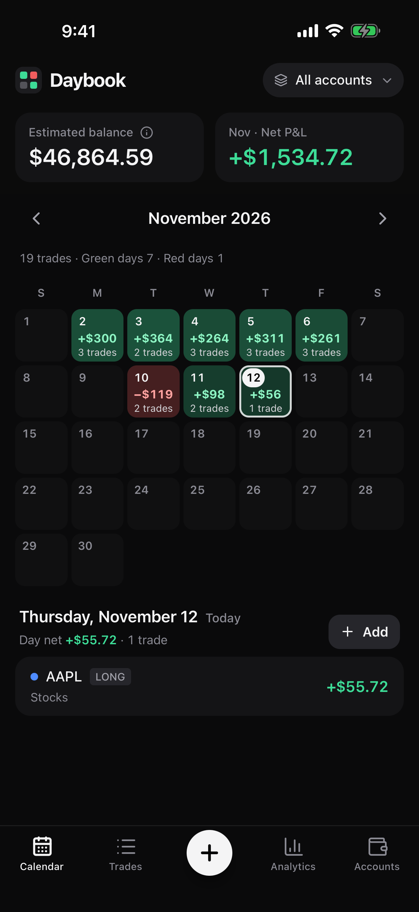
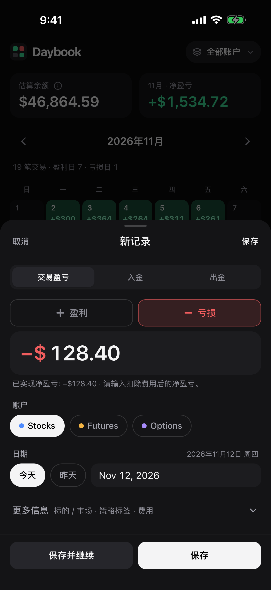
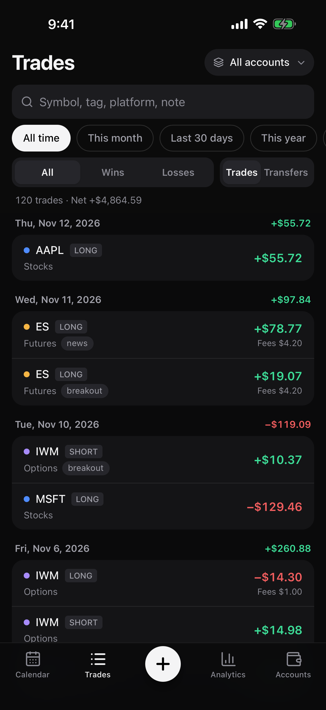
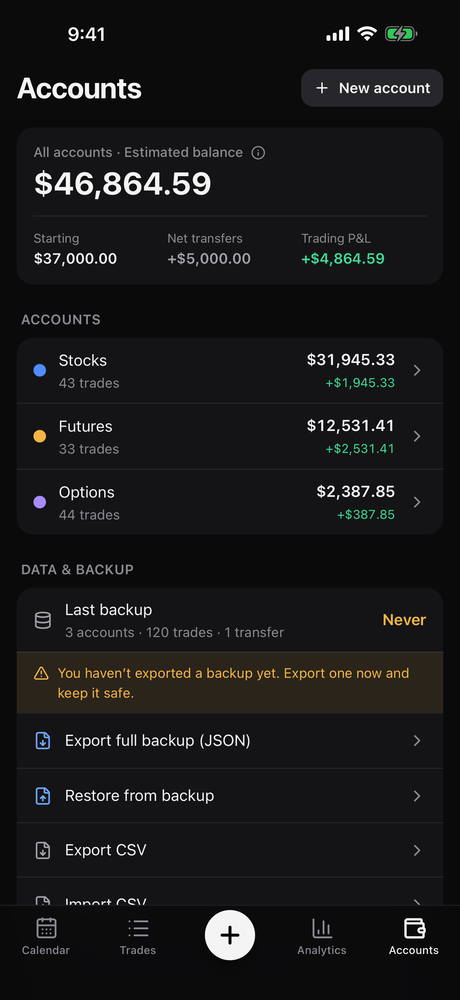

# Daybook — P&L Journal

一款本地优先（local-first）的个人交易盈亏日历 PWA。按天记录已实现盈亏，绿色盈利、红色亏损，一眼看清每天、每月和每个账户的表现。

- **无需注册、无服务器、无订阅、无外部 API、无统计/广告 SDK。** 数据只保存在你设备浏览器的 IndexedDB 中。
- **iPhone 优先**：可添加到主屏幕独立运行，首次加载后可离线使用，适配刘海与 Home Indicator。
- 中英文界面（默认跟随系统，可在「账户 → 偏好设置」中切换）。

| 日历 | 快速记录 | 统计 | 备份 |
| --- | --- | --- | --- |
|  |  |  |  |

截图来自生产构建，使用合成演示数据，在 Chromium 中模拟 iPhone 14 尺寸（不是 iOS Safari 真机截图）。

---

## 当前状态（v1.1 网页版）——已验证与未验证

iOS App（v1.2）的验证状态见下方「iOS App 验证状态」。

| 能力 | 状态 | 依据 |
| --- | --- | --- |
| 账务计算（盈亏、余额、入金出金分离、美分精度） | ✅ 自动化验证 | 单元测试 + E2E 场景 A/B |
| 备份导出 → 清空 → 恢复后完全一致 | ✅ 自动化验证 | 单元 + E2E 场景 C + 验收测试 |
| 备份任意字段被改动/损坏时拒绝恢复（SHA-256） | ✅ 自动化验证 | 对每个字段逐一篡改的测试 |
| v1.0 旧备份可恢复 | ✅ 自动化验证 | 使用 v1.0 代码真实导出的备份文件 |
| 恢复失败时数据库不被部分修改（事务回滚） | ✅ 自动化验证 | 注入写入失败与读回不一致 |
| 合并恢复的冲突规则、已删除记录不复活、无孤立交易、两台设备双向合并后一致 | ✅ 自动化验证 | 单元测试（规则 R1–R6） |
| 时区/跨年/闰年/月末/夏令时日期 | ✅ 自动化验证 | 4 个时区 E2E |
| 离线冷启动、离线记录、恢复联网后数据仍在 | ✅ Chromium 验证 | E2E |
| 新版本发布 → 提示 → 更新，数据与未保存草稿保留 | ✅ Chromium 验证 | E2E（模拟一次真实部署） |
| 375 / 390 / 430 / 1280px 及 320px 布局 | ✅ Chromium 验证 | E2E + 截图人工检查 |
| WCAG 2.1 AA（含对比度）自动审查、非颜色正负提示 | ✅ axe-core 验证 | E2E |
| 无第三方请求、CSP 阻止外发数据、导入内容 XSS 无效 | ✅ Chromium 验证 | E2E |
| WebKit 引擎（Playwright WebKit，Linux，iPhone 14 模拟）：账务、备份恢复、CSV、时区、布局、iPhone 专项、无障碍、安全 | ✅ 25 项在 GitHub Actions 通过 | CI 运行 42168475671 |
| WebKit 下的 Service Worker 离线 / 更新 / 全生命周期验收 | ❌ 未验证 | 这些测试只在 Chromium 中运行 |
| **真实 iPhone 上的 iOS Safari** | ❌ **未验证** | Playwright WebKit ≠ iOS Safari；需要下面的真机验收 |
| iOS 分享面板「存储到“文件”」、文件选择器、数字键盘、主屏幕模式、VoiceOver 朗读 | ❌ **未验证**（已按 iOS 规则实现并在 Chromium 中模拟） | 需要下面的真机验收 |

CI（`.github/workflows/ci-deploy.yml`）在每次推送时运行类型检查、单元测试、Chromium + WebKit E2E 和生产构建。

## iPhone 真机验收（约 10 分钟）

更简短的版本见 [docs/iPhone安装与验收指南.md](docs/iPhone安装与验收指南.md)。

部署到 HTTPS 地址后，在 iPhone 上按顺序做一遍。任何一步不符合预期，请不要开始记录真实数据。

1. **安装**：Safari 打开地址 → 分享 → 添加到主屏幕 → 从主屏幕图标打开。「账户 → 数据与备份」应显示「正在以主屏幕 App 方式运行」。
2. **记录**：点 `+`，数字键盘应直接弹出；输入 `1234.56`，选「盈利」，日期选昨天，展开更多信息填标的 `TEST`、费用 `1.23`，保存。日历中昨天显示绿色 `+$1.2K`，点开该日显示 `+$1,234.56`。键盘弹出时「保存」按钮可见。
3. **退出再开**：从多任务界面上滑关闭 App，重新打开，交易仍在且金额一致。
4. **离线**：打开飞行模式，关闭并重新打开 App → 能正常打开、能看到交易；再记录一笔 `−10`；关闭飞行模式，交易仍在。
5. **导出**：账户 → 导出完整备份 → 点「分享 / 存储到“文件”」→ 存储到“文件” → iCloud 云盘。在「文件」App 中能看到 `daybook-backup-….json`。
6. **恢复**：账户 → 从备份恢复 → 选择刚才的文件（文件不应为灰色不可选）→ 显示「校验通过（SHA-256）」→ 合并 → 数据不变、无重复。
7. **更新**：发布一个新版本后，回到 App（必要时关闭再打开），顶部出现「有新版本可用」→ 点刷新 → 交易仍在、金额一致。
8. **辅助功能（可选）**：打开 VoiceOver，点日历中有记录的日期，应朗读「日期、+$1,234.56、1 trade」。
9. 验收完成后，删除 `TEST` 交易（或「清空全部数据」）再开始记录真实交易。

## 快速开始（开发）

需要 Node.js 20+（开发使用 Node 22）。

```bash
npm install
```

```bash
npm run dev          # 开发服务器 http://localhost:5173（同时监听局域网）
```

```bash
npm run build        # 类型检查 + 生产构建 → dist/
```

```bash
npm run preview      # http://localhost:4173 预览生产构建（含 Service Worker）
```

```bash
npm test             # 单元测试（Vitest）
```

```bash
npm run e2e          # E2E（Playwright，自动构建并启动预览）；PW_WEBKIT=1 时额外跑 WebKit
```

## 在线版（GitHub Pages，HTTPS）

**https://zijianyuan-gh.github.io/pnl-app/**

`.github/workflows/ci-deploy.yml` 在每次推送到 `main` 时：
1. 运行类型检查、单元测试、Chromium + WebKit E2E（针对 `/pnl-app/` 子路径的正式构建）和发布检查（`npm run check:dist`：不得含测试交易、备份文件或密钥，必须带 CSP）；
2. 全部通过后，把**这份已测试的构建**发布到 `gh-pages` 分支；
3. 等待线上地址返回本次提交的构建（`<meta name="daybook-build">`），再在**真实线上地址**上运行 Chromium + WebKit 检查：首页、快速记录、统计、账户、中英文、手机布局、HTTPS 下的 Service Worker 离线、退出重开、备份恢复，以及“重新部署后旧数据仍在”（跨部署保留同一个浏览器配置文件进行核对）。

数据只保存在访问者自己设备的浏览器里，网站本身不含任何数据。重新部署只替换代码文件，不会触碰浏览器中的 IndexedDB。地址与数据绑定，请一直使用这个地址。

## Mac 本地版

一个独立的 `Daybook.app`（内置网页版和一个只监听本机 `127.0.0.1:47823` 的微型服务器，无需安装 Node 或其他依赖），在 macOS GitHub 运行器上构建并测试（Chromium + WebKit、服务器停止后离线可用、重启后数据仍在、安装脚本与真实启动）。

**安装 / 更新**（终端中粘贴一行）：

```bash
curl -fsSL https://raw.githubusercontent.com/zijianyuan-gh/pnl-app/main/mac/install.sh | bash
```

安装到 `~/Applications/Daybook.app` 并打开；以后从 Spotlight 或启动台打开 Daybook 即可，它会在默认浏览器中打开 `http://127.0.0.1:47823/`。也可以直接下载 [Daybook-mac.zip](https://github.com/zijianyuan-gh/pnl-app/releases/latest/download/Daybook-mac.zip)，解压后首次打开需在「系统设置 → 隐私与安全性」中点「仍要打开」（应用未经 Apple 付费公证）。

本地版的数据保存在 Mac 默认浏览器中（地址 `127.0.0.1:47823`），与 iPhone、在线版互相独立；在设备之间迁移请使用备份导出与恢复。

## iOS App（v1.2，准备上架 App Store）

`ios/` 是用 Capacitor 8 生成的原生 Xcode 项目，复用同一套 React 代码与业务逻辑：

- **离线优先**：生产构建的网页资源在 `npx cap sync ios` 时被打包进 App，从 `capacitor://localhost` 读取，从不加载网站；首次安装后无网络也能录入、查看、编辑。
- **原生能力**（`ios/App/App/DaybookNativePlugin.swift`）：系统分享面板（存储到“文件”）、「文件」文档选择器导入备份/CSV、自动备份副本（文件 → 我的 iPhone → Daybook，保留前一天的副本）、面容 ID / 触控 ID / 设备密码应用锁（明确说明只是屏幕锁，不是加密）、多任务界面隐私遮罩。
- **只申请一项权限**：面容 ID（仅用于可选的应用锁）。
- **数据保护**：App 存储为空且存在自动备份副本时提示恢复；从不用空数据库覆盖副本；「清空全部数据」之前的副本不会再被提示。
- **标识**：Bundle ID `io.github.zijianyuangh.daybook`，版本 1.2.0（build 1），仅 iPhone，iOS 15+。`npm run ios:version` 递增 build 号。

### iOS App 验证状态（如实区分）

**已实际构建并自动化验证**（GitHub Actions `macos` 运行器，Xcode 26.6，iOS 26.5 模拟器 iPhone 17 Pro Max；每次推送都会重跑，结果截图与日志发布在 `ios-ci-output` 分支）：

| 内容 | 结果 |
| --- | --- |
| 模拟器 Debug 构建（App + UI 测试） | ✅ 编译通过 |
| 打包内容：`public/index.html` 存在、配置中没有远程 `server.url`、生产 CSP 存在 | ✅ |
| 全新安装、App 为空时，提示从 App 的 Documents 中的备份恢复（CI 预置的是网页版格式的合成备份）：120 笔交易、余额一致，重启后仍在且不再提示 | ✅ test1 |
| 中英文 App Store 截图（5 张 × 2 种语言，1320 × 2868） | ✅ test2 |
| 点 + 后金额输入框立即获得键盘焦点；屏幕键盘弹出时金额与「保存」位于键盘之上 | ✅ test2（真实屏幕键盘） |
| 记录一笔交易，杀掉 App 重新启动后仍在 | ✅ test3 |
| 导出完整备份打开系统分享面板，含「存储到“文件”」 | ✅ test4 |
| 「从备份恢复」通过系统「文件」选择器选取文件 → SHA-256 校验 → 合并不产生重复 | ✅ test5（文件中 2 个备份可见；合并结果 0 新增 · 0 更新 · 0 删除） |
| 面容 ID 应用锁：开启需认证；切到后台再回来、重新启动后都被锁定；无匹配时保持锁定；匹配后解锁；关闭也需认证 | ✅ test6（连续 3 次后台/返回循环；CI 用模拟面容 ID，仅在测试请求时匹配） |
| Release 真机架构归档（`generic/platform=iOS`，arm64，未签名） | ✅ `ARCHIVE SUCCEEDED`，arm64，`io.github.zijianyuangh.daybook` 1.2.0 (1) |

**仅完成代码与配置（需要你的 Apple 开发者账号才能验证）**：代码签名、证书与描述文件、App Store Connect 记录、上传、TestFlight、App 审核。我没有申请任何证书，也没有上传或提交。

**尚未在真机上验证**：真实 iPhone 上的面容 ID / 触控 ID、iCloud 云盘中的「文件」读写、App 切换器隐私遮罩的实际效果、真实设备性能与 VoiceOver。请用 TestFlight 或 Xcode 安装到自己的 iPhone 后按 `docs/iPhone安装与验收指南.md` 第 6 节走一遍。

| 日历 | 快速记录（中文） | 统计 | 账户 |
| --- | --- | --- | --- |
|  |  |  |  |

以上为 iOS App 在模拟器中由 UI 测试自动截取（合成演示数据）。

常用命令（需要 macOS + Xcode）：

```bash
npm run ios:sync    # 生产构建并同步进 iOS 项目
```

```bash
npm run ios:open    # 用 Xcode 打开
```

**PWA → iOS App 迁移**：在网页版「账户 → 导出完整备份」→ 存储到“文件”；在 iOS App「账户 → 从备份恢复」→ 选择该文件 → 替换或合并。网页版数据不会因此被删除。详见 `docs/appstore/README.md`。

App Store 上架材料（元数据中英文、审核说明、隐私问卷答案、审核指南对照、截图）在 `docs/appstore/`。隐私政策与支持页面：<https://zijianyuan-gh.github.io/pnl-app/privacy.html>、<https://zijianyuan-gh.github.io/pnl-app/support.html>。

## 数据备份与恢复

**备份**：账户 → 数据与备份 → 导出完整备份（JSON）。iPhone 上会先生成文件，再点「分享 / 存储到“文件”」打开 iOS 分享面板，选择「存储到“文件”」→ iCloud 云盘或“我的 iPhone”。**Daybook 无法自行写入 iCloud 云盘**，必须由你在分享面板中保存。超过 14 天未备份会提醒。

**恢复**：账户 → 从备份恢复 → 选择文件 → 查看摘要与校验结果 → 选择：
- **替换当前全部数据**：用于换机或清空后恢复（二次确认，可立即撤销；若恢复后数据又有改动，撤销会被拒绝，现有数据全部保留）；
- **合并到当前数据**：按记录合并，不产生重复（规则见下）。

**备份安全说明**：备份文件**未加密**，包含完整交易记录。请只保存在你信任的私密位置（如自己的 iCloud 云盘），不要通过邮件、聊天软件发送，也不要提交到 Git 仓库（`.gitignore` 已排除 `daybook-backup-*.json` 与 `daybook-trades-*.csv`）。

**完整性校验的含义**：v1.1 备份包含对整个文件规范化 JSON 计算的 **SHA-256** 摘要，任何字段被改动、文件被截断或损坏，恢复都会被拒绝。它用于**发现意外损坏和误改**，**不是数字签名**：故意篡改的人可以重新计算摘要，它无法证明文件由谁创建。v1.0 旧备份只能校验记录数量与总盈亏，界面会明确提示。

**合并规则**（每条记录按 ID；删除记录带时间戳）：
- R1 只在一侧存在的记录会被加入——除非另一侧有不早于它的删除记录（同一时刻按“删除”处理，避免已删除的记录复活）。
- R2 两侧都存在：`updatedAt` 更新的一方胜出；完全同时保留本机版本。
- R3 备份中的删除只会删除比它更早修改的本地记录；之后在本机编辑或撤销删除的记录会保留。
- R4 账户删除会连带删除其中的记录，从不留下“孤立交易”；但如果账户或其中任一记录在删除之后又被修改过，账户会被保留。
- R5 删除记录合并保存，供以后的合并使用。R6 合并不改变设置。

## 数据丢失风险评估

已覆盖：恢复失败回滚、撤销不会覆盖之后的新数据（恢复与 CSV 导入）、损坏备份拒绝、未保存记录草稿保护（更新、iOS 杀后台、误关闭）、删除/恢复/导入均可撤销、清空与删除账户需输入确认、导出前自检、新版本不会自动刷新打断输入、数据库升级不清空数据（只追加 schema 版本）。

仍然存在、需要你配合的风险：
- **设备丢失、删除主屏幕 App、清除 Safari 网站数据** 都会删除本地数据 → 定期导出备份到 iCloud 云盘。
- 在 Safari 标签页（而非主屏幕 App）中使用时，Safari 可能清理一周未访问网站的数据，且与主屏幕 App 数据不互通 → App 会提示，请只在主屏幕 App 中记录。
- 浏览器可能在存储空间不足时清理数据；App 会申请“持久化存储”，在「数据与备份」中显示是否获准。

## 隐私与安全

- 运行时只请求同源资源；生产构建带严格 **Content-Security-Policy**（`connect-src 'self'` 等），即使出现 XSS 漏洞也无法把数据发往其他服务器。
- 不使用 `innerHTML`/`eval`；导入的 CSV/JSON 内容只作为文本显示（有专门的 XSS 测试）；CSV 导出中和电子表格公式注入。
- 不向控制台打印交易数据；无统计、广告、崩溃上报 SDK。
- 仓库中只有代码与合成测试数据（`tests/fixtures/backup-v1.0.json`），无真实财务记录、密钥或令牌。
- 未保存的快速记录草稿保存在本机 `localStorage`（同一设备、同一 Origin），保存或丢弃后删除。

## 功能清单

- **日历**：周日至周六月历，盈亏金额与笔数，颜色深浅随金额变化；所有金额带 `+`/`−` 符号；今天与选中日区分；左右滑动换月；点日期查看当天明细。
- **快速记录**：账户 → 日期 → 盈利/亏损 → 金额 → 保存；支持小数逗号（如 `12,50`）；可选标的、平台、标签、费用（明确说明已含在净盈亏中，不会重复扣除）、备注、方向、价格、时间、数量；连续录入；编辑、删除、撤销；草稿自动保存。
- **交易历史**：按日期分组；账户、时间范围、盈亏、关键词筛选；交易 / 资金切换。
- **统计**：区间、累计、本月净盈亏；累计曲线；交易胜率与盈利日占比分开定义；平均盈亏、盈利因子、最佳/最差交易日、连续盈利/亏损日；每月柱状图（可切换表格）；按标签汇总。
- **账户**：多账户、初始余额、余额起算日、颜色；交易盈亏 / 入金 / 出金 / 估算余额分开；归档与删除。
- **数据**：JSON 备份恢复（SHA-256 校验、替换或合并、可撤销）、CSV 导入（列映射、预览、校验、重复检测、可撤销）与导出、持久化存储状态、主屏幕模式检测。

## 技术方案

React 19 + TypeScript + Vite 8 + Tailwind CSS 4；IndexedDB（Dexie 4）；vite-plugin-pwa（Workbox，prompt 更新模式）；自绘 SVG 图表；lucide-react 图标；Vitest、Playwright、axe-core 测试。

- 金额以**整数美分**存储与计算；交易日期存为不带时区的 `YYYY-MM-DD`。
- 数据库 schema 只追加版本（`src/db/db.ts`）；备份格式有独立版本号与升级入口（`src/db/backup.ts`）。每条记录有 UUID、`createdAt`、`updatedAt`，删除记录保存为 tombstone，便于将来同步。

## 测试

```bash
npm run typecheck && npm test && npm run e2e
```

- 单元测试 95 项：金额（含小数逗号与非法分组）、日期、统计、CSV、账务场景 A/B/C、SHA-256（对照 Node crypto）、逐字段篡改检测、v1.0 兼容、事务回滚、合并规则 R1–R6、双设备收敛、精度与余额边界、撤销冲突（恢复后新增/修改/删除交易、资金、账户及 CSV 导入后修改时，撤销被拒绝且数据不变）。
- E2E（Chromium，iPhone 14 模拟 + 桌面）：账务、编辑删除撤销、备份恢复（含 v1.0 文件与撤销）、CSV 导入、时区、布局、PWA 离线与更新、**真实交易全生命周期验收**、iPhone 专项（分享面板手势、无分享面板时下载、键盘遮挡、安全区、草稿、小数逗号、主屏幕模式、axe 无障碍）、安全（同源、CSP、XSS）。
- iOS 原生（XCUITest，在 GitHub Actions 的 macOS + iOS 模拟器中运行真实 App，`ios/App/AppUITests/AppUITests.swift`）：PWA 格式备份在全新安装的 App 中恢复并在重启后保留、App Store 截图（英文 + 中文）、Quick Add 打开即聚焦金额并位于屏幕键盘之上、记录交易后重启仍在、导出打开系统分享面板（含「存储到“文件”」）、「文件」选择器恢复、面容 ID 应用锁（无匹配时保持锁定）；另有 Release 版真机架构归档（未签名）。单元测试 `tests/unit/ios-config.test.ts` 检查权限只有面容 ID、不加载远程 URL、Bundle ID 与版本号一致、图标规格、插件注册。

## 已知限制

- 未在真实 iPhone Safari / WebKit 上测试；iOS App 只在 iOS 模拟器中验证过，未在真机上运行（见上方验收步骤与 `docs/iPhone安装与验收指南.md` 第 6 节）。
- 不跨设备同步（设计如此），只能通过备份文件迁移。
- 仅 USD；仅记录已实现盈亏；仅深色主题；不支持 iOS 动态字体（Dynamic Type）缩放。
- CSV 重复检测基于「账户 + 日期 + 净盈亏 + 标的」，同日同标的同金额的两笔真实交易会被标为疑似重复（可选择仍然导入）。
- 合并恢复后，两台设备上分别创建的同名账户会显示为两个账户。

## 目录结构

```
src/
  App.tsx                 底部导航、路由、更新横幅
  state/app.tsx           全局状态（实时查询、提示、确认框、快速记录）
  screens/                日历 / 交易 / 统计 / 账户
  components/             快速记录、图表、导出/恢复/CSV 导入、通用 UI
  db/                     Dexie 数据库、校验、写操作（含撤销）、备份与合并、CSV 落库
  lib/                    金额、日期、统计、CSV、SHA-256、文件、平台检测（纯函数为主）
  i18n/                   中英文文案
tests/unit/ tests/e2e/ tests/fixtures/
.github/workflows/ci-deploy.yml   测试 → GitHub Pages 发布 → 线上验证；Mac 应用构建与发布
mac/                              Mac 启动器（server.ts）与一行安装脚本
docs/screenshots/                 生产构建截图（合成数据）
```
