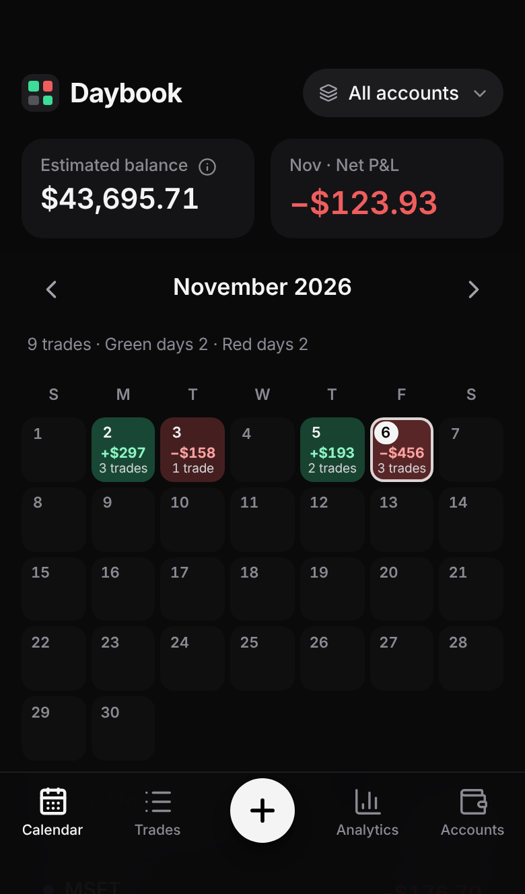
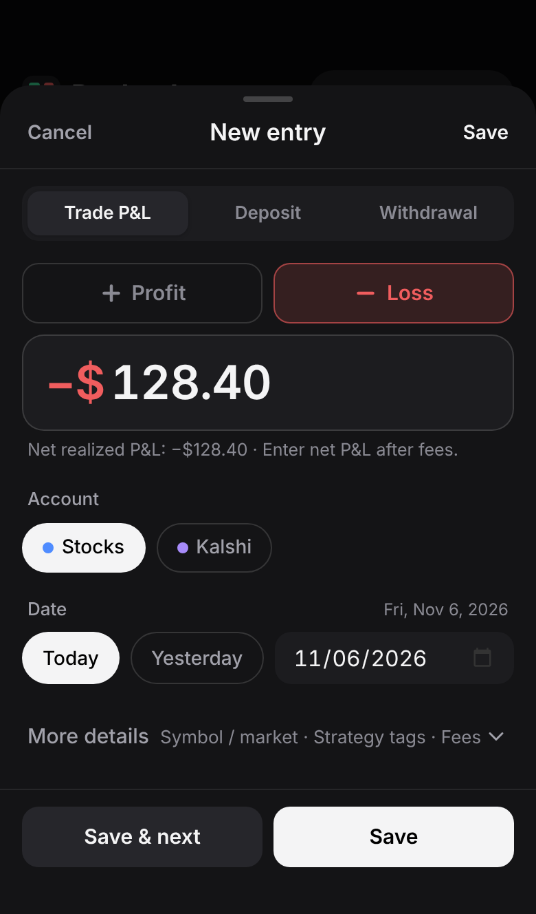
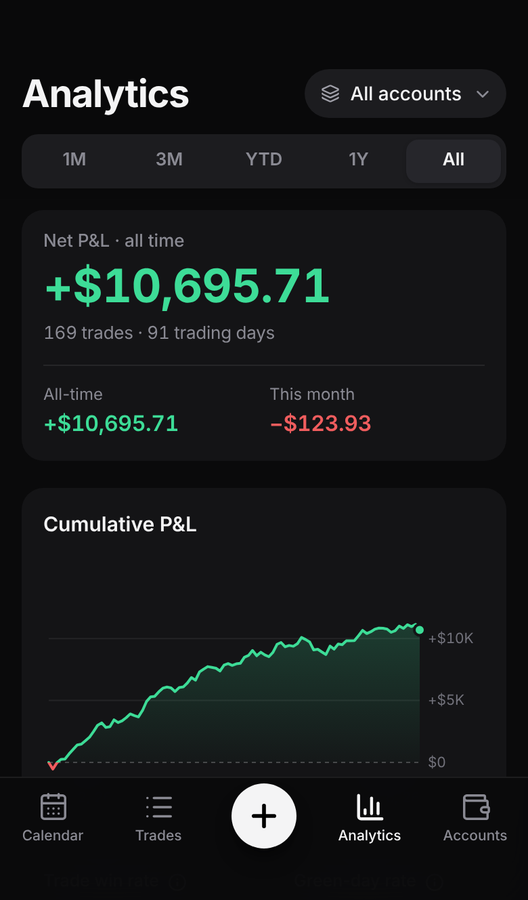
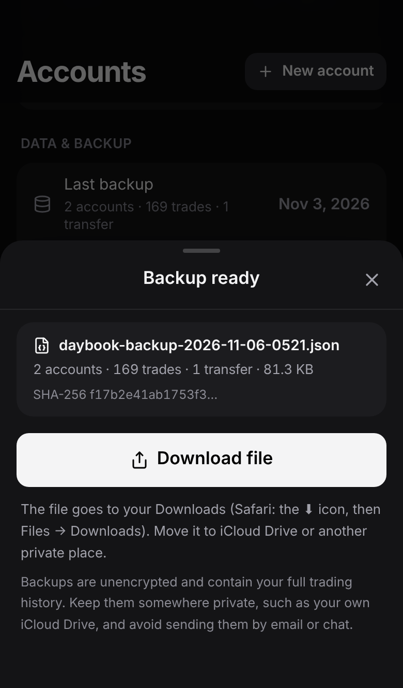

# Daybook — P&L Journal

一款本地优先（local-first）的个人交易盈亏日历 PWA。按天记录已实现盈亏，绿色盈利、红色亏损，一眼看清每天、每月和每个账户的表现。

- **无需注册、无服务器、无订阅、无外部 API、无统计/广告 SDK。** 数据只保存在你设备浏览器的 IndexedDB 中。
- **iPhone 优先**：可添加到主屏幕独立运行，首次加载后可离线使用，适配刘海与 Home Indicator。
- 中英文界面（默认跟随系统，可在「账户 → 偏好设置」中切换）。

| 日历 | 快速记录 | 统计 | 备份 |
| --- | --- | --- | --- |
|  |  |  |  |

截图来自生产构建，使用合成演示数据，在 Chromium 中模拟 iPhone 14 尺寸（不是 iOS Safari 真机截图）。

---

## 当前状态（v1.1）——已验证与未验证

| 能力 | 状态 | 依据 |
| --- | --- | --- |
| 账务计算（盈亏、余额、入金出金分离、美分精度） | ✅ 自动化验证 | 单元测试 + E2E 场景 A/B |
| 备份导出 → 清空 → 恢复后完全一致 | ✅ 自动化验证 | 单元 + E2E 场景 C + 验收测试 |
| 备份任意字段被改动/损坏时拒绝恢复（SHA-256） | ✅ 自动化验证 | 对每个字段逐一篡改的测试 |
| v1.0 旧备份可恢复 | ✅ 自动化验证 | 使用 v1.0 代码真实导出的备份文件 |
| 恢复失败时数据库不被部分修改（事务回滚） | ✅ 自动化验证 | 注入写入失败与读回不一致 |
| 合并恢复的冲突规则、已删除记录不复活、无孤立交易、两台设备双向合并后一致 | ✅ 自动化验证 | 单元测试（规则 R1–R6） |
| 时区/跨年/闰年/月末/夏令时日期 | ✅ 自动化验证 | 4 个时区 E2E |
| 离线冷启动、离线记录、恢复联网后数据仍在 | ✅ Chromium 验证 | E2E |
| 新版本发布 → 提示 → 更新，数据与未保存草稿保留 | ✅ Chromium 验证 | E2E（模拟一次真实部署） |
| 375 / 390 / 430 / 1280px 及 320px 布局 | ✅ Chromium 验证 | E2E + 截图人工检查 |
| WCAG 2.1 AA（含对比度）自动审查、非颜色正负提示 | ✅ axe-core 验证 | E2E |
| 无第三方请求、CSP 阻止外发数据、导入内容 XSS 无效 | ✅ Chromium 验证 | E2E |
| **iOS Safari / WebKit 实际行为** | ❌ **未验证** | 本开发环境只有 Chromium，无法运行 WebKit 或真机 |
| iOS 分享面板「存储到“文件”」、文件选择器、数字键盘、主屏幕模式、VoiceOver 朗读 | ❌ **未验证**（已按 iOS 规则实现并在 Chromium 中模拟） | 需要下面的真机验收 |

CI（`.github/workflows/ci-deploy.yml`）会在 GitHub 上额外运行 **Playwright WebKit** 测试；第一次在 CI 中运行前，WebKit 结果同样视为未验证。

## iPhone 真机验收（约 10 分钟）

部署到 HTTPS 地址后，在 iPhone 上按顺序做一遍。任何一步不符合预期，请不要开始记录真实数据。

1. **安装**：Safari 打开地址 → 分享 → 添加到主屏幕 → 从主屏幕图标打开。「账户 → 数据与备份」应显示「正在以主屏幕 App 方式运行」。
2. **记录**：点 `+`，数字键盘应直接弹出；输入 `1234.56`，选「盈利」，日期选昨天，展开更多信息填标的 `TEST`、费用 `1.23`，保存。日历中昨天显示绿色 `+$1.2K`，点开该日显示 `+$1,234.56`。键盘弹出时「保存」按钮可见。
3. **退出再开**：从多任务界面上滑关闭 App，重新打开，交易仍在且金额一致。
4. **离线**：打开飞行模式，关闭并重新打开 App → 能正常打开、能看到交易；再记录一笔 `−10`；关闭飞行模式，交易仍在。
5. **导出**：账户 → 导出完整备份 → 点「分享 / 存储到“文件”」→ 存储到“文件” → iCloud 云盘。在「文件」App 中能看到 `daybook-backup-….json`。
6. **恢复**：账户 → 从备份恢复 → 选择刚才的文件（文件不应为灰色不可选）→ 显示「校验通过（SHA-256）」→ 合并 → 数据不变、无重复。
7. **更新**：发布一个新版本后，回到 App（必要时关闭再打开），顶部出现「有新版本可用」→ 点刷新 → 交易仍在、金额一致。
8. **辅助功能（可选）**：打开 VoiceOver，点日历中有记录的日期，应朗读「日期、+$1,234.56、1 trade」。
9. 验收完成后，删除 `TEST` 交易（或「清空全部数据」）再开始记录真实交易。

## 快速开始（开发）

需要 Node.js 20+（开发使用 Node 22）。

```bash
npm install
```

```bash
npm run dev          # 开发服务器 http://localhost:5173（同时监听局域网）
```

```bash
npm run build        # 类型检查 + 生产构建 → dist/
```

```bash
npm run preview      # http://localhost:4173 预览生产构建（含 Service Worker）
```

```bash
npm test             # 单元测试（Vitest）
```

```bash
npm run e2e          # E2E（Playwright，自动构建并启动预览）；PW_WEBKIT=1 时额外跑 WebKit
```

## 稳定 HTTPS 安装：Cloudflare Pages（推荐，免费）

选择 Cloudflare Pages 的独立 `*.pages.dev` 地址，使这款财务 App 拥有**自己独立的 Web Origin**（不与其他网站共享存储）。GitHub Pages 的 `<用户名>.github.io` 由你所有 Pages 站点共享同一个 Origin，因此只作为备选（`deploy/github-pages.yml`，未启用）。

工作流 `.github/workflows/ci-deploy.yml`：每次推送都运行类型检查、单元测试、Chromium + WebKit E2E 和生产构建；**只有全部通过、并且你完成下面的一次性授权后**才会部署到 `https://daybook-pnl.pages.dev`。未授权时它只跑测试，不发布任何东西。

**需要你完成的一次性授权（我没有执行）：**

1. 注册/登录免费的 Cloudflare 账户。
2. Cloudflare → My Profile → API Tokens → Create Token → 自定义，仅授予 **Account · Cloudflare Pages · Edit** 权限。
3. GitHub 仓库 → Settings → Secrets and variables → Actions：
   - Secrets：`CLOUDFLARE_API_TOKEN`（上一步的 token）、`CLOUDFLARE_ACCOUNT_ID`（Cloudflare 控制台右侧的 Account ID）；
   - Variables：`DEPLOY_ENABLED` = `true`。
4. 在 Actions 页面手动运行一次 “CI & deploy”，或推送到 `main`。

注意：
- 项目名 `daybook-pnl` 若已被他人占用，Cloudflare 会分配带后缀的地址，以实际地址为准。**确定地址后不要再更换**：浏览器数据与 Origin 绑定，换地址等于换了一个空 App（只能靠备份迁移）。
- 部署内容只有静态代码，不包含任何个人数据；任何人都能打开这个（空的）应用，但只能看到他们自己设备里的数据。
- 不涉及你已有的其他域名或服务。

## 数据备份与恢复

**备份**：账户 → 数据与备份 → 导出完整备份（JSON）。iPhone 上会先生成文件，再点「分享 / 存储到“文件”」打开 iOS 分享面板，选择「存储到“文件”」→ iCloud 云盘或“我的 iPhone”。**Daybook 无法自行写入 iCloud 云盘**，必须由你在分享面板中保存。超过 14 天未备份会提醒。

**恢复**：账户 → 从备份恢复 → 选择文件 → 查看摘要与校验结果 → 选择：
- **替换当前全部数据**：用于换机或清空后恢复（二次确认，可立即撤销）；
- **合并到当前数据**：按记录合并，不产生重复（规则见下）。

**备份安全说明**：备份文件**未加密**，包含完整交易记录。请只保存在你信任的私密位置（如自己的 iCloud 云盘），不要通过邮件、聊天软件发送，也不要提交到 Git 仓库（`.gitignore` 已排除 `daybook-backup-*.json` 与 `daybook-trades-*.csv`）。

**完整性校验的含义**：v1.1 备份包含对整个文件规范化 JSON 计算的 **SHA-256** 摘要，任何字段被改动、文件被截断或损坏，恢复都会被拒绝。它用于**发现意外损坏和误改**，**不是数字签名**：故意篡改的人可以重新计算摘要，它无法证明文件由谁创建。v1.0 旧备份只能校验记录数量与总盈亏，界面会明确提示。

**合并规则**（每条记录按 ID；删除记录带时间戳）：
- R1 只在一侧存在的记录会被加入——除非另一侧有不早于它的删除记录（同一时刻按“删除”处理，避免已删除的记录复活）。
- R2 两侧都存在：`updatedAt` 更新的一方胜出；完全同时保留本机版本。
- R3 备份中的删除只会删除比它更早修改的本地记录；之后在本机编辑或撤销删除的记录会保留。
- R4 账户删除会连带删除其中的记录，从不留下“孤立交易”；但如果账户或其中任一记录在删除之后又被修改过，账户会被保留。
- R5 删除记录合并保存，供以后的合并使用。R6 合并不改变设置。

## 数据丢失风险评估

已覆盖：恢复失败回滚、损坏备份拒绝、未保存记录草稿保护（更新、iOS 杀后台、误关闭）、删除/恢复/导入均可撤销、清空与删除账户需输入确认、导出前自检、新版本不会自动刷新打断输入、数据库升级不清空数据（只追加 schema 版本）。

仍然存在、需要你配合的风险：
- **设备丢失、删除主屏幕 App、清除 Safari 网站数据** 都会删除本地数据 → 定期导出备份到 iCloud 云盘。
- 在 Safari 标签页（而非主屏幕 App）中使用时，Safari 可能清理一周未访问网站的数据，且与主屏幕 App 数据不互通 → App 会提示，请只在主屏幕 App 中记录。
- 浏览器可能在存储空间不足时清理数据；App 会申请“持久化存储”，在「数据与备份」中显示是否获准。

## 隐私与安全

- 运行时只请求同源资源；生产构建带严格 **Content-Security-Policy**（`connect-src 'self'` 等），即使出现 XSS 漏洞也无法把数据发往其他服务器。
- 不使用 `innerHTML`/`eval`；导入的 CSV/JSON 内容只作为文本显示（有专门的 XSS 测试）；CSV 导出中和电子表格公式注入。
- 不向控制台打印交易数据；无统计、广告、崩溃上报 SDK。
- 仓库中只有代码与合成测试数据（`tests/fixtures/backup-v1.0.json`），无真实财务记录、密钥或令牌。
- 未保存的快速记录草稿保存在本机 `localStorage`（同一设备、同一 Origin），保存或丢弃后删除。

## 功能清单

- **日历**：周日至周六月历，盈亏金额与笔数，颜色深浅随金额变化；所有金额带 `+`/`−` 符号；今天与选中日区分；左右滑动换月；点日期查看当天明细。
- **快速记录**：账户 → 日期 → 盈利/亏损 → 金额 → 保存；支持小数逗号（如 `12,50`）；可选标的、平台、标签、费用（明确说明已含在净盈亏中，不会重复扣除）、备注、方向、价格、时间、数量；连续录入；编辑、删除、撤销；草稿自动保存。
- **交易历史**：按日期分组；账户、时间范围、盈亏、关键词筛选；交易 / 资金切换。
- **统计**：区间、累计、本月净盈亏；累计曲线；交易胜率与盈利日占比分开定义；平均盈亏、盈利因子、最佳/最差交易日、连续盈利/亏损日；每月柱状图（可切换表格）；按标签汇总。
- **账户**：多账户、初始余额、余额起算日、颜色；交易盈亏 / 入金 / 出金 / 估算余额分开；归档与删除。
- **数据**：JSON 备份恢复（SHA-256 校验、替换或合并、可撤销）、CSV 导入（列映射、预览、校验、重复检测、可撤销）与导出、持久化存储状态、主屏幕模式检测。

## 技术方案

React 19 + TypeScript + Vite 8 + Tailwind CSS 4；IndexedDB（Dexie 4）；vite-plugin-pwa（Workbox，prompt 更新模式）；自绘 SVG 图表；lucide-react 图标；Vitest、Playwright、axe-core 测试。

- 金额以**整数美分**存储与计算；交易日期存为不带时区的 `YYYY-MM-DD`。
- 数据库 schema 只追加版本（`src/db/db.ts`）；备份格式有独立版本号与升级入口（`src/db/backup.ts`）。每条记录有 UUID、`createdAt`、`updatedAt`，删除记录保存为 tombstone，便于将来同步。

## 测试

```bash
npm run typecheck && npm test && npm run e2e
```

- 单元测试 65 项：金额（含小数逗号与非法分组）、日期、统计、CSV、账务场景 A/B/C、SHA-256（对照 Node crypto）、逐字段篡改检测、v1.0 兼容、事务回滚、合并规则 R1–R6、双设备收敛、精度与余额边界。
- E2E（Chromium，iPhone 14 模拟 + 桌面）：账务、编辑删除撤销、备份恢复（含 v1.0 文件与撤销）、CSV 导入、时区、布局、PWA 离线与更新、**真实交易全生命周期验收**、iPhone 专项（分享面板手势、无分享面板时下载、键盘遮挡、安全区、草稿、小数逗号、主屏幕模式、axe 无障碍）、安全（同源、CSP、XSS）。

## 已知限制

- 未在真实 iPhone Safari / WebKit 上测试（见上方验收步骤）。
- 不跨设备同步（设计如此），只能通过备份文件迁移。
- 仅 USD；仅记录已实现盈亏；仅深色主题；不支持 iOS 动态字体（Dynamic Type）缩放。
- CSV 重复检测基于「账户 + 日期 + 净盈亏 + 标的」，同日同标的同金额的两笔真实交易会被标为疑似重复（可选择仍然导入）。
- 合并恢复后，两台设备上分别创建的同名账户会显示为两个账户。

## 目录结构

```
src/
  App.tsx                 底部导航、路由、更新横幅
  state/app.tsx           全局状态（实时查询、提示、确认框、快速记录）
  screens/                日历 / 交易 / 统计 / 账户
  components/             快速记录、图表、导出/恢复/CSV 导入、通用 UI
  db/                     Dexie 数据库、校验、写操作（含撤销）、备份与合并、CSV 落库
  lib/                    金额、日期、统计、CSV、SHA-256、文件、平台检测（纯函数为主）
  i18n/                   中英文文案
tests/unit/ tests/e2e/ tests/fixtures/
.github/workflows/ci-deploy.yml   CI + Cloudflare Pages 部署（需一次性授权）
deploy/github-pages.yml           GitHub Pages 备选模板（未启用）
docs/screenshots/                 生产构建截图（合成数据）
```
