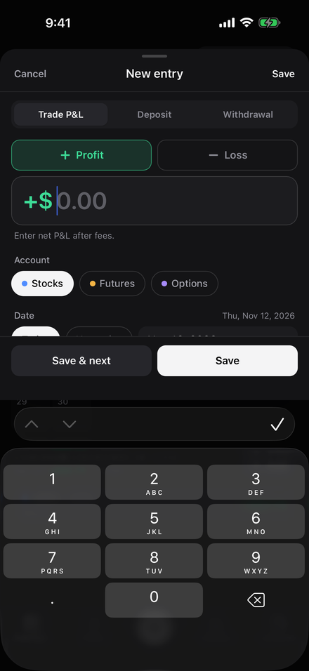
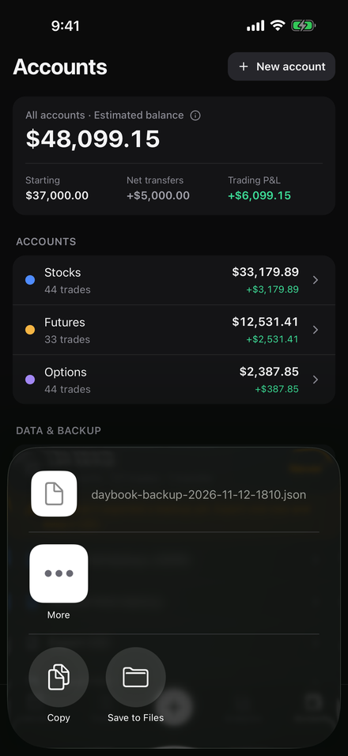
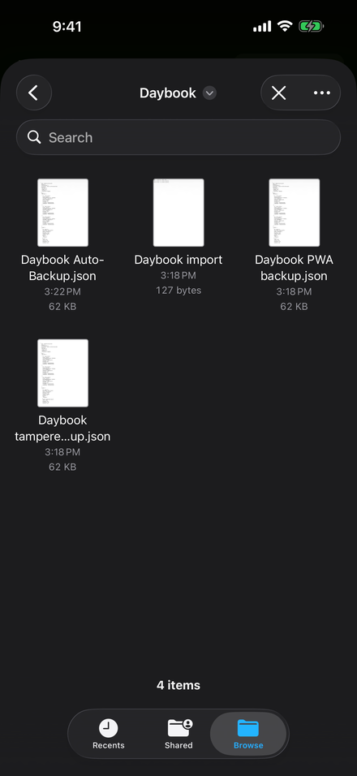
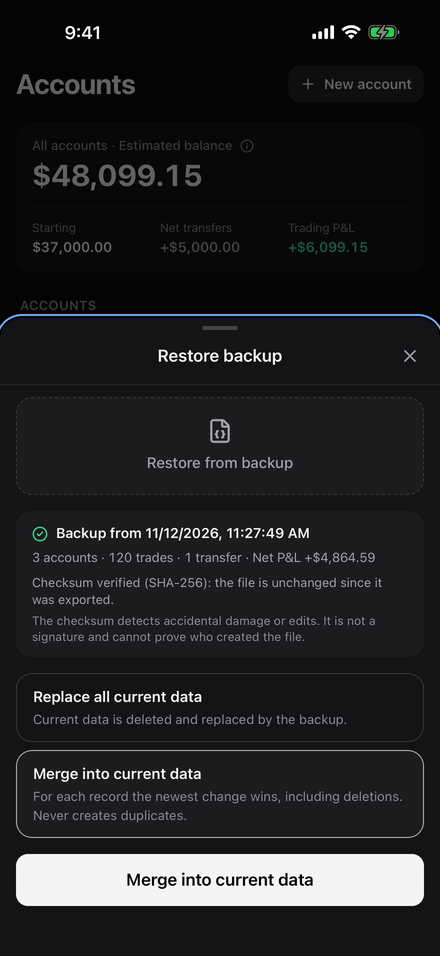
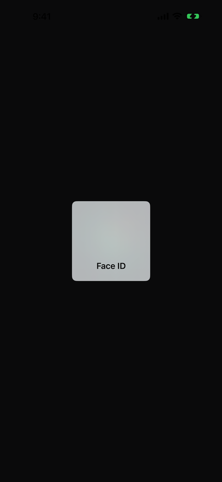
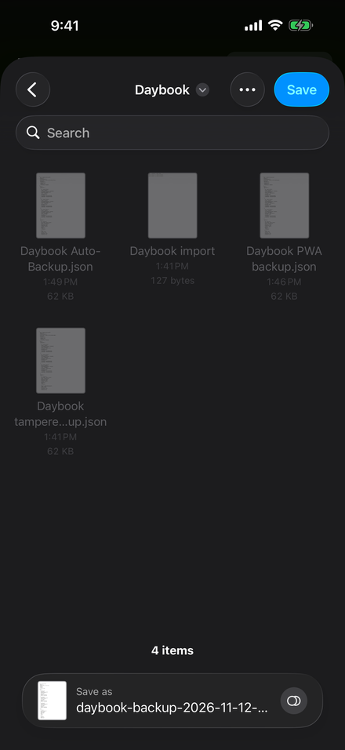
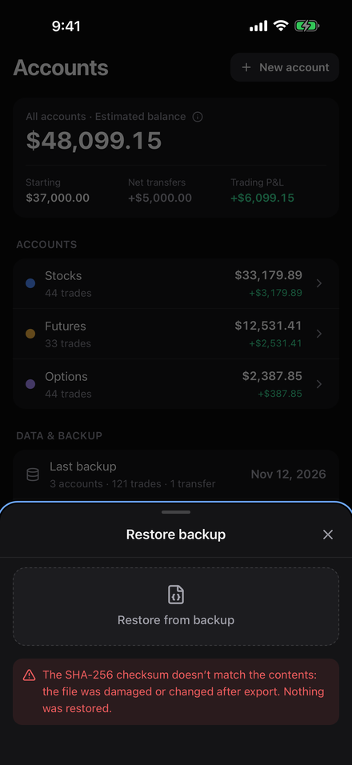
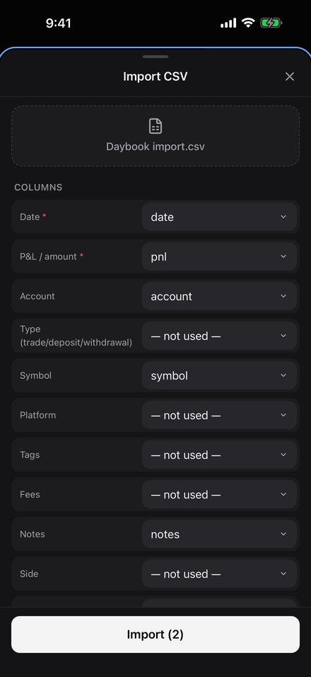
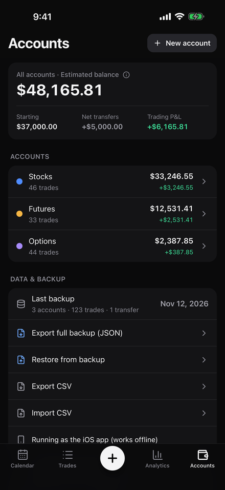
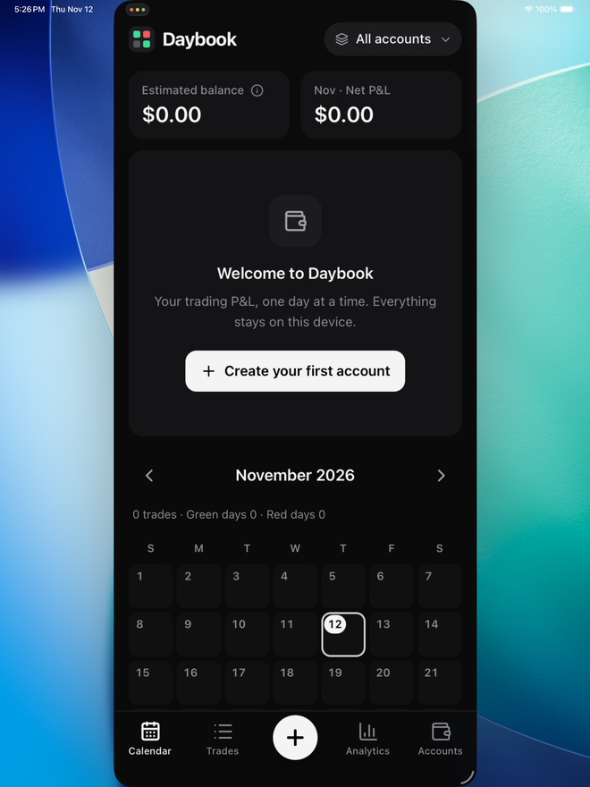

# Daybook V1.2 验收报告（注册 Apple Developer 账号之前）

日期：2026-11-12 · 代码版本：`{{COMMIT}}` · CI：[{{RUN}}](https://github.com/zijianyuan-gh/pnl-app/actions/runs/{{RUN}})（全部 5 个任务通过）

> 本报告只写实际运行过的结果。iOS 部分全部在 GitHub Actions 的 macOS 运行器上用 **iOS 模拟器** 完成；**没有在真实 iPhone 上运行过，没有签名、上传或提交 App Store**。

## 结论

| 范围 | 结果 |
| --- | --- |
| iOS 编译（模拟器 Debug、真机架构 Release 归档） | ✅ 通过；Daybook 自己的 Swift 代码 {{WARN}} 个编译警告 |
| iOS 原生 UI 测试（真实 App，模拟器） | ✅ 10 / 10 通过（9 项 + 更新后数据检查），0 跳过 |
| iPhone App 在 iPad 上运行（兼容模式） | {{IPAD}} |
| 网页版单元测试 | ✅ 99 / 99 |
| 网页版 E2E（Chromium，iPhone 尺寸 + 桌面） | ✅ 43 通过；另 19 项按设计只在另一种设备配置下运行 |
| 线上网站（GitHub Pages）检查 | ✅ 通过（含隐私政策、支持页） |
| Mac 本地版 | ✅ 构建与测试通过 |
| 已知严重缺陷 | 无 |

## 1. 构建

| 检查 | 结果 |
| --- | --- |
| 模拟器 Debug 构建（App + UI 测试），Xcode 26.6 / iOS 26.5 SDK | ✅ |
| Release 归档 `generic/platform=iOS`（未签名） | ✅ `ARCHIVE SUCCEEDED`，arm64 |
| 归档中的 Bundle ID / 版本 / build | `io.github.zijianyuangh.daybook` · 1.2.0 · 1 |
| 网页资源打包在 App 内（`public/index.html`），无远程 `server.url`，生产 CSP | ✅ |
| App 图标（Assets.car、CFBundleIconName） | ✅ |
| 隐私清单 `PrivacyInfo.xcprivacy` 在 App 内且声明 UserDefaults（CA92.1）、文件时间戳（C617.1） | ✅ |
| Release 二进制中没有 UI 测试用的预置代码；没有开启网页调试器 | ✅ |

## 2. iOS 原生功能（XCUITest，iPhone 17 Pro Max 模拟器）

CI 先放入一份**合成**的网页版格式备份（120 笔交易）、一份被改动过的备份和一个 CSV；测试按顺序在同一台模拟器上运行。

| # | 测试 | 验证内容 | 结果 | 证据 |
| --- | --- | --- | --- | --- |
| 1 | 首次启动恢复 | 全新安装、数据库为空时提示恢复；恢复后 120 笔交易、余额 $46,864.59 与备份一致；重启后仍在，不再提示 | ✅ | — |
| 2 | 截图与键盘 | 中英文各 5 张 App Store 截图；点 + 后金额框立即获得键盘焦点；**屏幕键盘**弹出时金额框底部 y=320，键盘顶部 y=655，「保存」在键盘之上 | ✅ |  |
| 3 | 记录与持久化 | 记录 +$1,234.56，杀掉 App 重启后仍在当天列表中 | ✅ | — |
| 4 | 分享面板与外部链接 | 导出打开系统分享面板（含「存储到“文件”」）；**取消时不记为已备份**；「隐私政策」在 Safari 中打开，App 本身不浏览网页 | ✅ |   |
| 5 | 从「文件」恢复 | 系统「文件」选择器 → 我的 iPhone → Daybook → 选择网页版备份 → SHA-256 校验通过 → 合并：0 新增 · 0 更新 · 0 删除，数据计数不变 | ✅ |   |
| 6 | 面容 ID 应用锁 | 开启前必须认证（无匹配时保持关闭）；连续 3 次切到后台再回来都被锁定，无匹配时 3 秒内保持锁定，匹配后解锁；重启后锁定；关闭也需认证 | ✅ |  |
| 7 | 存储到“文件”往返 | 导出 → 存储到“文件” → 我的 iPhone/Daybook → 存储；「上次备份」从「从未」变为日期；再从该文件恢复：校验通过、0 新增 | ✅ |  |
| 8 | 被改动的备份 | 选择改动过的备份 → 「SHA-256 校验不匹配……没有恢复任何内容」，没有恢复按钮；数据计数不变，重启后也不变 | ✅ |  |
| 9 | CSV 导入 | 通过「文件」选择器导入 2 行 CSV → 预览「Import (2)」→ 导入 2 笔，当天列表显示 +$77.77 与 −$11.11 | ✅ |  |
| Z | 更新后数据仍在 | CI 在已有数据的安装上再次安装同一 App（程序包路径改变、数据容器不变），启动后没有恢复提示，「3 个账户 · 123 笔交易 · 1 条资金记录」与测试 3、9 的记录都在 | ✅ |  |

iPad 兼容模式（App 仅面向 iPhone，Apple 审核时可能在 iPad 上打开）：{{IPAD_DETAIL}}

测试源码：`ios/App/AppUITests/AppUITests.swift`；每次 CI 的完整日志、截图与界面结构发布在 `ios-ci-output` 分支。

## 3. 数据安全

| 要求 | 依据 |
| --- | --- |
| 升级 / 新构建不删除网页版（PWA）数据 | 网页版与 iOS App 存储互相独立；网页版的数据库只追加版本（单元测试 + E2E「新版本发布后数据保留」） |
| iOS App 升级不丢数据 | 测试 Z：在原有安装上再次安装 App（与 App Store 更新相同：替换程序、保留数据），之后 123 笔交易与全部记录都在；网页存储的来源固定为 `capacitor://localhost`（单元测试防止误改）；另有自动备份副本（文件 → 我的 iPhone → Daybook，保留前一天的副本），数据库为空时提示恢复（测试 1） |
| 导入网页版备份，保留账户、交易、资金记录与日期 | 测试 1、5、7；单元测试逐字段比较 |
| 导入失败不破坏现有数据 | 测试 8（改动过的文件被拒绝、数据不变）；单元测试：写入失败事务回滚、读回不一致回滚 |
| 合并不产生重复 | 测试 5、7（0 新增）；单元测试规则 R1–R6 |
| 恢复可撤销，且撤销不会覆盖之后的新数据 | 单元测试 + E2E |
| 选取的备份文件不在 App 临时目录中留存 | `DaybookNativePlugin.pickFile` 读取后删除副本 |
| 不收集、不上传任何数据 | 无网络请求代码、CSP `connect-src 'self'`、E2E 检查只有同源请求且控制台不输出数据；隐私清单「不追踪、不收集」 |
| 应用锁不被宣传为加密 | App 内说明、支持页、审核说明均写明「屏幕锁，不加密数据」 |

## 4. 网页版（PWA）

- 线上地址 https://zijianyuan-gh.github.io/pnl-app/ ：每次推送先通过测试再发布，发布后在真实地址上运行线上检查（含 `privacy.html`、`support.html`）。
- iOS 相关改动只在原生环境中生效（`isNative()`）；网页版界面与行为不变，现有 E2E 全部通过。

## 5. App Store 材料（`docs/appstore/`）

| 材料 | 状态 |
| --- | --- |
| 名称、副标题、关键词、描述、更新说明（英文 + 简体中文） | ✅ `metadata-en.md`、`metadata-zh-Hans.md` |
| 类别 Finance（如实，不规避金融审核）；明确写明不交易、不托管资金、不提供投资建议 | ✅ |
| 隐私政策（含 App 内链接）、支持页 | ✅ 已上线 |
| App 隐私问卷答案（不收集数据）、出口合规、隐私清单 | ✅ `privacy-label.md` |
| 审核说明 | ✅ `review-notes.md`（需填写你的联系方式） |
| 审核指南 4.1 / 4.2 / 4.3 / 3.2.1 / 5.1 对照与剩余风险 | ✅ `guidelines.md` |
| 截图 6.9 英寸 1320 × 2868（英文 5 张、中文 5 张，真实 App、合成数据） | ✅ `screenshots/` |
| Bundle ID、版本与 build 号规则 | ✅ `io.github.zijianyuangh.daybook`，1.2.0 (1)，`npm run ios:version` |

## 6. 尚未验证（需要你的账号或真机）

- **需要 Apple Developer 账号**：代码签名、App Store Connect 记录、上传、TestFlight、审核结果。
- **需要真实 iPhone**：真实面容 ID / 触控 ID、iCloud 云盘中的「文件」读写、App 切换器隐私遮罩的实际效果、真机性能、VoiceOver 实际朗读。按 `docs/iPhone安装与验收指南.md` 第 6 节检查。
- CI 中的面容 ID 是模拟器的模拟匹配，不等同于真机。

## 7. 本轮发现并修复的问题

| 问题 | 严重程度 | 修复 |
| --- | --- | --- |
| 应用锁：刚解锁就立刻切到后台时，偶尔回来不再上锁（只依赖网页的 visibilitychange 事件） | 高 | 由 iOS 原生「进入后台」事件触发上锁；隐私遮罩保持到锁屏画面绘制完成；测试改为连续 3 次循环 |
| 缺少隐私清单 `PrivacyInfo.xcprivacy`（上传会被 App Store Connect 拒收） | 高（发布阻断） | 新增并加入 App；CI 检查 Release 归档 |
| 从「文件」选取的备份副本留在 App 临时目录 | 低（隐私） | 读取后删除 |
| 中文「跟随系统」在语言切换中折成两行 | 低 | 不换行 |
| App Store 截图中的演示账户使用券商品牌名 | 低（审核风险） | 改为通用名称 |
| 中文「统计」App Store 截图实际是「交易」页面（切换标签的点击丢失后仍截了图） | 中（误导性截图） | 截图前确认目标页面已显示，点击丢失时重试；复制截图的脚本拒绝内容完全相同的截图 |
| UI 测试在较慢的 CI 机器上偶发失败（回到前台、切换语言后立即操作），且一个失败会连带后续测试 | 测试稳定性 | 等待 App 真正回到前台、检查选项与面板状态而不是固定等待；后续测试启动时恢复默认状态（不掩盖原失败） |

## 8. 已知限制（不属于缺陷）

- 仅美元；仅深色主题；不支持动态字体缩放；不跨设备同步（用备份文件迁移）。
- 网页版与 iOS App 数据互相独立，需要用备份文件迁移一次。
